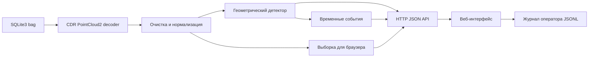

# Технический план веб-решения

Версия 2.1 от 19.09.2026. ROS и Docker исключены из целевой архитектуры по новому указанию организаторов. Порядок реализации, контрольные точки и определение финальной готовности задаёт [FINALIZATION_PLAN.md](FINALIZATION_PLAN.md).

## Архитектура



Приложение запускается локально командой:

```powershell
.\scripts\run_web.ps1
```

После запуска интерфейс доступен по адресу `http://127.0.0.1:8000`.

## Реализованный MVP

- `webapp/bag_store.py` — обнаружение `.db3`, метаданные и чтение кадра;
- `webapp/detector.py` — очистка, опасный коридор, воксельные компоненты и расстояние;
- `webapp/server.py` — статические файлы и JSON API;
- `webapp/static/` — браузерный интерфейс без CDN;
- `tests/test_web_detector.py` — синтетические проверки;
- `scripts/run_web.ps1` — единая команда запуска.

API:

| Метод | Путь | Назначение |
|---|---|---|
| GET | `/api/health` | состояние сервера |
| GET | `/api/bags` | список доступных записей |
| GET | `/api/frame` | обработанный кадр, точки и объекты |
| POST | `/api/feedback` | решение оператора по тревоге |

## Этап 1. Модель штатной сцены

Текущий baseline находит положительные объекты, но принимает часть инфраструктуры за препятствия. Следующая версия должна:

1. Оценивать уровень пола отдельно по продольным сегментам.
2. Выделять устойчивые линии рельсов и не считать их объектами.
3. Строить профиль свободного пространства по чистым bag.
4. Сравнивать занятость текущего кадра с допустимым профилем, не требуя точного совпадения кадров.
5. Использовать пороги числа точек, зависящие от дальности.
6. Сохранять диагностическую причину каждой тревоги.

Низкие объекты проверяются отдельной веткой: локальное превышение над моделью пола либо отличие от нормального профиля. Высотный фильтр baseline не считается финальным решением.

## Этап 2. Кластеры и расстояние

1. Разделять связные компоненты по 3D-вокселям.
2. Отбрасывать длинные элементы инфраструктуры по форме и устойчивости во времени.
3. Хранить расстояние до ближайшей поверхности и до центра раздельно.
4. Добавить bbox, число точек, высоту над полом и признак пересечения габарита.
5. Проверить основной человек, отдельный предмет и второго человека вне пути.

## Этап 3. Временная логика

1. Связывать объекты соседних кадров по центру, размеру и расстоянию.
2. Хранить сырую и устойчивую тревогу.
3. Подтверждать событие коротким гистерезисом и измерять задержку.
4. Сбрасывать состояние при смене bag или разрыве времени.

## Этап 4. Интерфейс

Обязательные функции:

- выбор записи и кадра;
- воспроизведение и пауза;
- виды сверху и сбоку;
- опасный коридор и боксы;
- состояние пути и ближайшее расстояние;
- время обработки и число точек;
- подтверждение/отклонение тревоги;
- журнал событий и экспорт JSON/CSV;
- понятная ошибка при отсутствии данных.

WebGL-сцена добавляется после стабилизации детектора. Текущие Canvas-проекции уже обеспечивают рабочую демонстрацию без внешних библиотек.

## Этап 5. Проверка

Для каждого bag сохраняются:

- число кадров и время обработки;
- доля кадров с сырой и устойчивой тревогой;
- события и их длительность;
- ложные тревоги в минуту для штатных записей;
- время первого обнаружения в положительной записи;
- p50/p95/p99 вычислительной части и полного HTTP-запроса.

Реальные и синтетические результаты приводятся отдельно. Метрика accuracy не используется как единственный показатель.

## Этап 6. Автономная упаковка

1. Зафиксировать поддерживаемую версию Python и NumPy.
2. Добавить установочный скрипт для виртуального окружения.
3. Не использовать CDN, облачные API или удалённые модели.
4. Проверить запуск из нового каталога с явным путём к данным.
5. Исключить из Git датасет, приватный чат, журнал оператора и временные кадры.

## Распределение команды

| Участник | Зона |
|---|---|
| 1 | Детектор, нормальная сцена, расстояние |
| 2 | Веб-интерфейс, API, воспроизведение и журнал |
| 3 | Прогоны, внешние решения, метрики, документация и защита |

Формат API меняется только вместе с примером ответа и проверкой интерфейса. Каждый день заканчивается воспроизводимым прогоном хотя бы одного положительного и одного штатного кадра.
