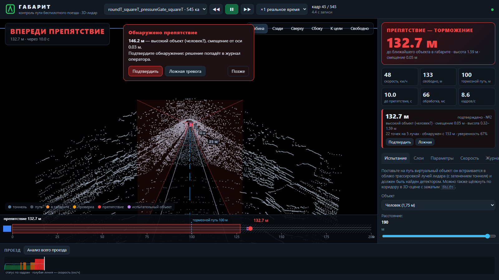
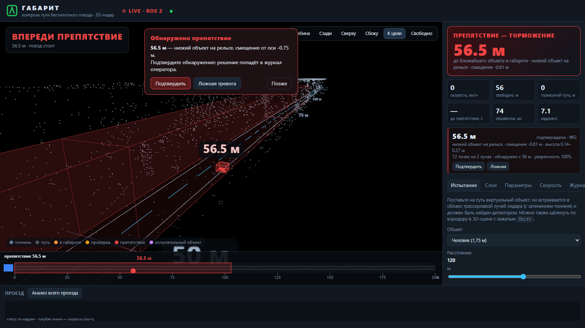

# Габарит — обнаружение препятствий перед беспилотным поездом метро по 3D-лидару

ЛЦТ 2026, задача №5 (Департамент транспорта). Решение отвечает на вопрос: **«Есть ли на пути поезда что-нибудь, чего там быть не должно, и на каком расстоянии?»** — по потоку облаков точек лидара HESAI Pandar128 в ROS 2.

- ROS 2 Humble узел: `PointCloud2` → `/gabarit/obstacle` (есть препятствие), `/gabarit/distance` (расстояние, м), `/gabarit/free_distance`, `/gabarit/status` (полный JSON), маркеры для RViz2.
- Docker-образ на Ubuntu 22.04 + ROS 2 Humble: `docker build` → `docker run` → `ros2 bag play` → результат.
- Веб-интерфейс оператора: 3D-сцена тоннеля с габаритом и препятствиями, подтверждение тревог оператором, испытательные объекты, анализ всего проезда, журнал.
- Без обучения на разметке: геометрия пути (рельсы, стены, пол, свод) + временное подтверждение. Работает на новых проездах без перенастройки, сам калибрует положение лидара.



## Быстрый старт (Docker, как на стенде)

```bash
docker build -t gabarit .
# демонстрация: узел + ros2 bag play; откройте http://localhost:8080
docker run --rm -it -p 8080:8080 -v /path/to/for_hackathon:/data gabarit demo doubleT_obstacle
```

Обычная схема «инженера метро» — детектор и воспроизведение в разных терминалах:

```bash
# терминал 1: детектор (подписывается на все PointCloud2-топики), live-интерфейс на :8080
docker run --rm -it --name gabarit --net=host -v /path/to/for_hackathon:/data gabarit
# терминал 2: воспроизведение записи в тот же ROS 2 граф
docker exec -it gabarit bash -c "source /opt/ros/humble/setup.bash && ros2 bag play /data/doubleT_obstacle"
# результат
docker exec -it gabarit bash -c "source /opt/ros/humble/setup.bash && ros2 topic echo /gabarit/distance"
```



С внешним ROS 2 (bag проигрывается на хосте): запустите контейнер с `--net=host --ipc=host` и тем же `RMW_IMPLEMENTATION` (в образе — `rmw_cyclonedds_cpp`); топик определяется автоматически или задаётся явно:
`docker run ... gabarit gabarit detect input_topic:=/lidar_points`.

Другие команды контейнера (`gabarit help`):

| Команда | Что делает |
|---|---|
| `detect` | ROS 2 узел + live-интерфейс :8080 (по умолчанию) |
| `demo <bag>` | узел + `ros2 bag play <bag>` |
| `web` | интерфейс воспроизведения без ROS на :8000 (перемотка, испытательные объекты): `docker run -p 8000:8000 -v …:/data gabarit gabarit web` |
| `evaluate` | прогон по всем записям `/data` → `/output/eval` (смонтируйте `-v $PWD/out:/output`) |
| `synthetic` | оценка дальности обнаружения на синтетических объектах → `/output/synthetic` |
| `test` | модульные тесты |

> На Windows/macOS с Docker Desktop `ros2 bag play` медленно читает sqlite через bind mount. Добавьте `-e GABARIT_COPY=1` к `demo` (запись копируется внутрь контейнера) — на Linux-стенде это не нужно.

## Запуск без Docker и ROS (Windows / Linux)

Нужен Python 3.10+.

```bash
pip install -r requirements.txt
python -m web.server --data data/extracted/for_hackathon     # http://localhost:8000
```

или двойной щелчок по `start_web.cmd` (Windows) / `./start_web.sh` (Linux) — окружение создаётся автоматически. Сервер сам читает bag-файлы (sqlite3 + CDR), ROS не нужен.

Пакетная обработка записей:

```bash
python scripts/evaluate.py data/extracted/for_hackathon --out artifacts/eval   # покадровые JSONL + сводка
python scripts/synthetic_eval.py data/extracted/for_hackathon --out artifacts/synthetic
python -m pytest -q tests
```

## Как это работает

```
PointCloud2 → самокалибровка по рельсам → путь впереди (рельсы до ~50 м, дальше стены/пол/свод)
            → эго-движение по текстуре тоннеля → точки внутри габарита 2,2 × 3,0 м
            → кластеры → отбраковка «нормального тоннеля» → подтверждение во времени
            → «путь свободен на X м» / «препятствие, Y м»
```

1. **Самокалибровка.** Два пика высоты на расстоянии колеи 1520 мм — рельсы. По ним оцениваются высота, тангаж и крен лидара (в наборе встречаются 1,07 м и 1,48 м с креном −3,5°).
2. **Путь впереди.** Вблизи — по рельсам, дальше — слежением фильтрами Калмана за стенами, полом и сводом, параллельными пути; затем робастное сглаживание со штрафом на изменение кривизны. Кривые радиусом 250–450 м отслеживаются до 100–150 м.
3. **Эго-движение.** Скорость поезда находится по корреляции текстуры тоннеля между кадрами: даёт прогноз треков, тормозной путь и время до препятствия.
4. **Габарит.** Всё, что внутри коридора шириной 2,2 м и высотой 3 м над головкой рельса, — кандидат. Отдельный детектор ищет **низкие предметы на рельсах** (выступ над головкой рельса).
5. **Отбраковка.** Стены на кривых, края платформ, колонны, кронштейны, светильники отсекаются по свойствам среды: протяжённость вдоль пути, продолжение за габарит, непрерывность «пол–свод», повторяемость вдоль стены.
6. **Подтверждение.** 3 кадра из 4 вблизи (~0,3 с), 6 из 8 дальше 60 м; до подтверждения — статус «ПРОВЕРКА» с запросом оператору.

Подробно: [алгоритм](docs/ALGORITHM.md), [архитектура](docs/ARCHITECTURE.md), [формат результата](docs/RESULT_FORMAT.md), [эксперименты](docs/EXPERIMENTS.md), [веб-интерфейс](docs/WEB_UI.md), [лидар Pandar128](docs/SENSOR_PANDAR128.md), [уточнения из Q&A](docs/QNA_NOTES.md).

## Результаты (подробно — [EXPERIMENTS.md](docs/EXPERIMENTS.md))

| Что проверяли | Результат |
|---|---|
| Реальный проезд с препятствиями | найдены **оба** объекта: человек, переходящий путь (55,6 м, подтверждён за 0,2 с после входа в габарит), и предмет на рельсе (56,4 м) |
| Ложные тревоги, 5 штатных проездов (2 287 кадров, 3,8 мин) | **13 событий** (прежняя версия — 36); на трёх проездах 0–1, 10 — два неподвижных объекта за стрелкой во время стоянки у станции |
| Дальность: человек (синтетика в реальных проездах, 16 сближений) | найден **16/16**, подтверждение в среднем на **124 м**, максимум **151 м** |
| Ребёнок / тележка / ящик 0,5 м | 16/16 каждый; ~100 м / ~101 м / ~59 м |
| Задержка на кадр (1 ядро CPU) | p95 **55 мс** (обычные облака), 75 мс (плотные 922 тыс. точек); в Docker при 10 Гц — 0 пропусков |
| Самокалибровка | лидар 1,07 м и 1,48 м с креном −3,5° определяются автоматически |

## Параметры

Все параметры — в [`config/gabarit.yaml`](config/gabarit.yaml) (значения по умолчанию в `gabarit/config.py`). Главные:

| Параметр | По умолчанию | Смысл |
|---|---|---|
| `envelope.width` / `envelope.height` | 2.2 / 3.0 | габарит, м (по Q&A) |
| `envelope.min_height` | 0.12 | нижняя граница над головкой рельса, м |
| `sensor.forward_axis` | `-y` | ось облака, направленная вперёд |
| `sensor.auto_calibration` | `true` | самокалибровка позы лидара по рельсам |
| `detection.max_range` | 200 | горизонт анализа, м |
| `tracking.confirm_hits` / `confirm_window` | 3 / 4 | подтверждение вблизи |
| `tracking.far_distance` | 60 | граница дальней зоны со строгим подтверждением, м |

Файл передаётся узлу параметром `config:=…` (`ros2 launch gabarit_ros gabarit.launch.py config:=/path/cfg.yaml`) или веб-серверу `--config`. В веб-интерфейсе габарит и режим чувствительности меняются на лету.

## Структура репозитория

```
gabarit/            ядро (NumPy): чтение bag, калибровка, путь, эго-движение, детекция, треки, синтетика
ros2/gabarit_ros/   ROS 2 пакет: узел, launch, конфигурация RViz2
web/                веб-сервер (aiohttp) и интерфейс (Three.js, без интернета)
scripts/            evaluate.py, synthetic_eval.py, диагностика, сборка презентации и записи видео
tests/              модульные тесты на синтетическом тоннеле
config/gabarit.yaml параметры
docker/             entrypoint и команды контейнера
docs/               документация; docs/archive — история предыдущей версии
Dockerfile
```
