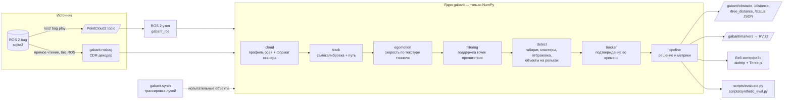

# Архитектура

## Компоненты

| Модуль | Назначение |
|---|---|
| `gabarit/rosbag.py` | чтение ROS 2 bag (sqlite3) и декодирование CDR `PointCloud2` без ROS — для веб-режима и оценки |
| `gabarit/cloud.py` | перевод полей в рабочую систему (`forward_axis`), сохранение номера луча и колонки, рабочее подмножество |
| `gabarit/track.py` | самокалибровка по рельсам; путь впереди: рельсы → стены/пол/свод (фильтры Калмана) → робастное сглаживание |
| `gabarit/egomotion.py` | скорость по корреляции текстуры тоннеля, перенос пути между кадрами |
| `gabarit/detect.py` | координаты пути, кандидаты в габарите, кластеризация, отбраковка инфраструктуры, детектор объектов на рельсах |
| `gabarit/filtering.py` | пространственная поддержка точек; одиночные и дублированные возвраты не подтверждают препятствие; исходная связность стен сохраняется |
| `gabarit/tracker.py` | треки, подтверждение, гистерезис |
| `gabarit/pipeline.py` | сборка цепочки, статус кадра, расстояния, время по этапам |
| `gabarit/synth.py` | синтетические препятствия трассировкой лучей в реальный скан (испытания и оценка дальности) |
| `gabarit/config.py` | все параметры; загрузка YAML/JSON |
| `gabarit/mlops.py` | управление моделью: версии параметров в MLflow Model Registry (pyfunc-модель `gabarit-detector`), прогоны оценки с метриками; без MLflow — локальный журнал |
| `web/admin.py` | один пользователь одновременно, приём записей (.db3 / .zip / .tar, потоково на диск), API панели администратора |
| `web/session.py` | сеанс воспроизведения, ручное управление просмотром, упаковка кадров |
| `ros2/gabarit_ros` | ROS 2 узел: подписка, публикация топиков и маркеров, встроенный live-интерфейс |
| `web/` | сервер (aiohttp, WebSocket, бинарные кадры) и одностраничный интерфейс (Three.js) |
| `gabarit/__main__.py` | единая команда `python -m gabarit` (web, run, evaluate, synthetic, check) — основной способ запуска без Docker и ROS |
| `scripts/` | пакетная оценка, синтетическая оценка дальности, диагностические рисунки |
| `tests/` | модульные тесты на синтетическом тоннеле, в том числе без набора данных |

## Потоки данных

- **Без ROS (основной режим)**: `python -m gabarit web|run|evaluate` читает bag напрямую (sqlite3 + CDR), тот же конвейер, что и в ROS 2 узле.
- **ROS 2** (на хосте через `ros2/run_ros2.sh` или в Docker): `ros2 bag play` → топик → узел → `/gabarit/*`. Входной QoS выбирается по издателю (Reliable/Best Effort), глубина 1. Управление bag и RViz описано в [DOCKER_GUI.md](DOCKER_GUI.md).
- **Веб-режим воспроизведения**: сервер сам читает bag (без ROS), обрабатывает кадры последовательно (трекинг требует порядка), отдаёт в браузер бинарный кадр: JSON-метаданные + `Float32` координаты + класс + интенсивность (~0,5–1 МБ). Перемотка = прогрев конвейера на 12 предыдущих кадрах.
- **Live-режим**: узел ROS 2 упаковывает каждый обработанный кадр и рассылает всем подключённым браузерам.
- **Загрузка записи**: браузер → `POST /api/upload` (токен сеанса или пароль администратора) → поток на диск в `data/uploads/<имя>/` → проверка чтением bag → запись появляется в списке.
- **Доступ**: WebSocket-сеанс воспроизведения допускается, если занято меньше `--max-users` мест (по умолчанию 1); иначе — сообщение «занят». Неактивный сеанс освобождается через `--idle-min` минут.
- **Управление моделью**: админ-панель → `gabarit.mlops` → MLflow (хранилище `artifacts/mlflow`, сервер `python -m gabarit mlflow`, http://localhost:5000).

## Производительность

Замеры прежней версии — в `docs/EXPERIMENTS.md`, доработки и новых записей —
в [FINALIST_UPDATE.md](FINALIST_UPDATE.md). BLAS принудительно однопоточный:
для малых матриц многопоточный OpenBLAS существенно замедляет решение систем.
Бюджет 10 Гц оценивается по доле кадров не дольше 100 мс, отдельно с чтением
и декодированием; средняя частота сама по себе не доказывает отсутствие задержек.
