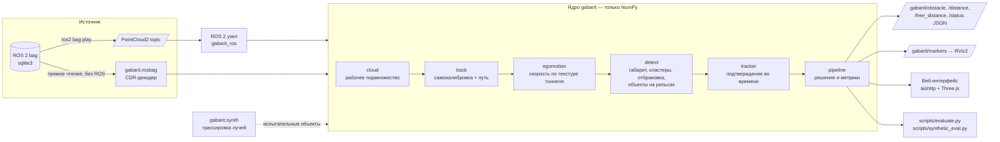

# Архитектура

## Компоненты

| Модуль | Назначение |
|---|---|
| `gabarit/rosbag.py` | чтение ROS 2 bag (sqlite3) и декодирование CDR `PointCloud2` без ROS — для веб-режима и оценки |
| `gabarit/cloud.py` | перевод полей в рабочую систему (`forward_axis`), сохранение номера луча и колонки, рабочее подмножество |
| `gabarit/track.py` | самокалибровка по рельсам; путь впереди: рельсы → стены/пол/свод (фильтры Калмана) → робастное сглаживание |
| `gabarit/egomotion.py` | скорость по корреляции текстуры тоннеля, перенос пути между кадрами |
| `gabarit/detect.py` | координаты пути, кандидаты в габарите, кластеризация, отбраковка инфраструктуры, детектор объектов на рельсах |
| `gabarit/tracker.py` | треки, подтверждение, гистерезис |
| `gabarit/pipeline.py` | сборка цепочки, статус кадра, тормозной путь, время по этапам |
| `gabarit/synth.py` | синтетические препятствия трассировкой лучей в реальный скан (испытания и оценка дальности) |
| `gabarit/config.py` | все параметры; загрузка YAML/JSON |
| `ros2/gabarit_ros` | ROS 2 узел: подписка, публикация топиков и маркеров, встроенный live-интерфейс |
| `web/` | сервер (aiohttp, WebSocket, бинарные кадры) и одностраничный интерфейс (Three.js) |
| `scripts/` | пакетная оценка, синтетическая оценка дальности, диагностические рисунки |
| `tests/` | модульные тесты на синтетическом тоннеле, в том числе без набора данных |

## Потоки данных

- **ROS 2**: `ros2 bag play` → топик → узел → `/gabarit/*`. Подписка надёжная, глубина 1: если кадр обрабатывается дольше периода лидара, берётся самый свежий (без накопления очереди). В образе используется CycloneDDS: облака набора занимают 8–24 МБ на сообщение.
- **Веб-режим воспроизведения**: сервер сам читает bag (без ROS), обрабатывает кадры последовательно (трекинг требует порядка), отдаёт в браузер бинарный кадр: JSON-метаданные + `Float32` координаты + класс + интенсивность (~0,5–1 МБ). Перемотка = прогрев конвейера на 12 предыдущих кадрах.
- **Live-режим**: узел ROS 2 упаковывает каждый обработанный кадр и рассылает всем подключённым браузерам.

## Производительность

Один кадр обрабатывается за 40–80 мс в одном потоке Python/NumPy (см. `docs/EXPERIMENTS.md`). BLAS принудительно однопоточный: для малых матриц многопоточный OpenBLAS замедлял решение систем в 100 раз.
