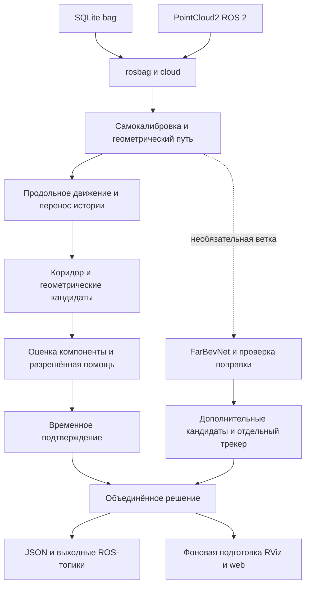

# Архитектура системы

Общее ядро `Pipeline` обрабатывает последовательность облаков для трёх адаптеров: чтение bag без ROS, ROS 2 и веб-воспроизведение. Решение опирается на геометрию пути и временное подтверждение. Необязательные модели имеют отдельные ограничения и диагностические поля.

## Компоненты

| Модуль | Ответственность |
|---|---|
| `gabarit/rosbag.py`, `cloud.py` | SQLite/CDR, поля PointCloud2, оси, лучи, рабочая область |
| `track.py`, `numerics.py` | калибровка, рельсы и конструкции тоннеля, сглаживание и неопределённость |
| `egomotion.py` | корреляция текстуры, оценка скорости, перенос пути между кадрами |
| `detect.py`, `filtering.py` | кандидаты, связные компоненты, поддержка точек, причины отбраковки |
| `component_model.py` | NumPy-исполнение лесов, история поддержки и ограниченная помощь |
| `learned_path.py`, `path_fusion.py` | FarBevNet, подготовка BEV, проверки согласованности дальней оси |
| `tracker.py`, `pipeline.py` | ассоциация, подтверждение, отдельные истории веток и итог кадра |
| `synth.py` | испытательные вставки с трассировкой лучей и перекрытиями |
| `annotation_sources.py` | независимое чтение геометрии MarkerArray и принадлежности возвратов |
| `web/session.py`, `server.py` | воспроизведение, бинарные кадры, live-рассылка и противодавление |
| `ros2/gabarit_ros/.../node.py`, `render_worker.py` | ROS-вход, решение, фоновая графика и защита при смене записи |
| `scripts/` | оценка, регрессия, разметка, обучение и измерение ROS |

## Изоляция необязательных моделей

Лес Sakhalin Ai по умолчанию работает в `score`: оценки не меняют решения геометрии. Собственный лес загружается явно из JSON и используется в профилях `component_trained*.yaml`. Разрешение помощи зависит от геометрии, числа независимых наблюдений и надёжности пути.

FarBevNet формирует дополнительную гипотезу. Для неё существует отдельный трекер; ошибочная нейросетевая ось не должна удалять геометрическое обнаружение или менять геометрический prior следующего кадра. Дополнительные обнаружения могут добавить ложную тревогу, поэтому изоляция веток сама по себе не доказывает улучшения качества. Подробности: [MODELS.md](MODELS.md).

## Потоки и очереди

Обработка кадров одного источника последовательная: состояние пути и треков зависит от порядка. В ROS входная глубина ограничена, перегрузка учитывается счётчиком и внешней проверкой timestamp. Пропуски DDS не определяются только локальным счётчиком callback.

Решения публикуются из callback. Подготовка `view_cloud` и `view_markers` вынесена в `LatestRenderer`: один строящийся кадр и один заменяемый ожидающий кадр. Эта очередь может пропускать промежуточную визуализацию при нагрузке, сохраняя актуальность. Это отличается от потери входных кадров детектора. Номер поколения предотвращает публикацию графики старой записи после reset.

LiveHub хранит последний кадр, строит payload по необходимости и не накапливает неограниченную очередь для медленного клиента. Без подключённых просмотрщиков лишняя упаковка не выполняется. Поле callback `web_pack` в ROS отражает передачу работы в эту цепочку, а не полное время доставки и рисования в браузере.

## Сброс и системы координат

При смене записи, перемотке времени, повторном timestamp, большом временном разрыве или смене frame_id соответствующая история сбрасывается. В веб-перемотке используется прогрев предыдущими кадрами. ROS-сервис `/gabarit/reset` сбрасывает историю и перечитывает выбранную конфигурацию.

Геометрия коридора задаётся в координатах пути `(s, d, h)`. Евклидова дальность от сенсора, расстояние вдоль пути и дальность свежих опор различаются. Удержанная геометрия служит отображению и сопровождению, но не увеличивает свежую свободную дальность. [Формат результата](RESULT_FORMAT.md).

## Воспроизводимость

Фиксированные сцены, seed и контрольные суммы находятся в `tests/fixtures/regression118`. Обучение воспроизводится из `training/component_forest_v1.features.json.gz`; bag-файлы для этого пути не требуются. Базовый runtime использует NumPy, aiohttp, PyYAML и threadpoolctl. PyTorch и scikit-learn подключаются отдельно. Тесты и сборка Docker проверяют разные части системы; текущие [границы измерений](VALIDATION_2026_11_12.md) сохраняются явно.
