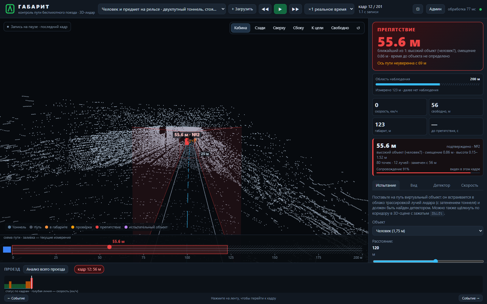

# Веб интерфейс оператора

Интерфейс использует aiohttp, WebSocket и локальную копию Three.js. Он показывает результаты ядра в режиме воспроизведения bag без ROS и в live-режиме ROS 2. Порядок запуска — в [INSTALLATION.md](INSTALLATION.md).

## Компоновка

Основная область содержит облако точек, габарит, ось пути и рамки объектов. Панель состояния показывает решение и дальность, карточки — отдельные треки, нижняя область — схему пути и таймлайн. При уменьшении окна компоновка адаптируется; доступны компактное представление и светлая тема.

Снимки сделаны 7 ноября 2026 года; доработки 10–11 ноября касались обработки и передачи кадров. Дополнительные виды: [сверху](screenshots/ui_20261107/02_top.png), [цель](screenshots/ui_20261107/03_target.png), [чистое облако](screenshots/ui_20261107/04_raw.png), [компактный](screenshots/ui_20261107/05_compact.png), [мобильный](screenshots/ui_20261107/06_mobile.png), [Falcon](screenshots/ui_20261107/07_falcon.png), [светлый](screenshots/ui_20261107/08_light.png).

## Чтение сцены

Текущая измеренная, неуверенная и удерживаемая части габарита различаются визуально. Серые или удержанные участки нельзя интерпретировать как проверенную свободную дальность. При потере свежих сообщений появляется предупреждение о потере потока.

Щелчок по объекту выбирает трек, связывает бокс с карточкой и позволяет сфокусировать камеру. Подписи и боксы стабилизируются, но их устойчивость на экране не заменяет независимую оценку локализации. Размерный тип объекта не является обученным семантическим классом.

| Управление | Действие |
|---|---|
| Пробел, кнопка пуска | воспроизведение или пауза |
| Стрелки и покадровые кнопки | предыдущий или следующий кадр |
| 1–6 | кабина, сзади, сверху, сбоку, к цели, свободная камера |
| Щелчок по объекту | выбор трека и карточки |
| Shift и щелчок по коридору | размещение испытательного объекта |
| Таймлайн или событие | переход к выбранному моменту записи |

## Настройки

«Испытание» управляет синтетическими объектами. «Вид» задаёт слои, раскраску и звук. «Детектор» задаёт габарит, чувствительность и профиль. «Скорость» показывает время обработки. Изменения конфигурации необходимо сохранять при сравнительном эксперименте.

Тревога не ставит запись на паузу. Дальность свободного пути ограничивается свежими измерениями, независимо от масштаба камеры. Для Falcon отображение поддерживает горизонт до 350 м, если его разрешает профиль.

## Доставка кадров

Воспроизведение сохраняет последовательный порядок обработки. В live-потоке медленный клиент получает актуальные кадры без неограниченного накопления очереди. Разрыв связи и устаревший результат должны быть видимы оператору. Пропуск промежуточной картинки не тождествен потере входного PointCloud2 детектором.

JavaScript-семантика проверяется настоящим Node.js в тестах `test_viewer_semantics.py`; это не заменяет полную визуальную проверку браузера. Последняя сохранённая проверка камер, WebGL, размеров окна и тем — от 7 ноября. Происхождение адаптированных функций подписей Sakhalin Ai указано в [уведомлениях об авторстве](../THIRD_PARTY_NOTICES.md).
