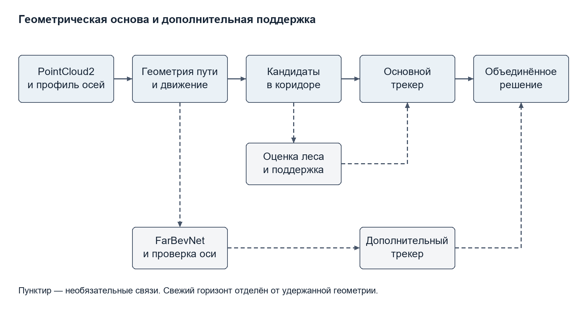

# Обнаружение препятствий в тоннеле метрополитена по облакам бортового лидара с учётом наблюдаемости пути и временной поддержки

Первый черновой каркас публикации для обсуждения с куратором

Версия от 12 ноября 2026 года к сроку 13 ноября 2026 года. Авторский состав, организации и контактный автор подлежат согласованию.

## Аннотация

Рассматривается обнаружение препятствий в коридоре движения поезда метро по последовательности облаков бортового 3D-лидара при ограниченной независимой разметке. Представлена система «Габарит», которая восстанавливает путь по рельсам и конструкциям тоннеля, формирует геометрические кандидаты и подтверждает их во времени. Предусмотрены отдельные ветки компактной обучаемой оценки объектов и нейросетевого уточнения дальней оси. Текущие наблюдения, удержанная геометрия и предел анализа учитываются раздельно. В фиксированном наборе из 118 синтетических сцен на двух реальных фоновых проездах сохранено обнаружение всех 112 целей, а число сторонних тревожных кадров уменьшено с пяти до нуля относительно предыдущей версии. На коротких измеренных участках базового ROS-конвейера с RViz и подключённым веб-просмотрщиком получена частота около 10 Гц без пропуска входных timestamp; p95 callback составляет 80,45–94,93 мс. Результаты являются предварительной регрессионной проверкой: полная независимая разметка реальных препятствий и слепое сравнение с внешними методами ещё не завершены.

Ключевые слова: бортовой лидар, метрополитен, облако точек, препятствия, геометрия пути, временное подтверждение, наблюдаемость, воспроизводимость.

## 1 Введение

Бортовое обнаружение препятствий требует одновременно определить положение пути и отделить вторжение в него от инфраструктуры. Для тоннеля эта зависимость существенна: небольшое смещение оценённой оси может включить в область движения стену, колонну или край платформы. На кривой неподходящая геометрия коридора создаёт тревогу даже при корректной локализации отдельных точек.

Задачу осложняет разреженность дальних возвратов и ограниченное разнообразие размеченных опасных ситуаций. В нашей исходной коллекции есть облака разных установок Pandar и Falcon, однако полного независимого описания реальных препятствий, их видимости и положения относительно выбранного маршрута пока нет. Следовательно, обучение и оценку следует строить так, чтобы не подменять независимую проверку предсказаниями самого детектора.

Современная литература включает обучаемую LiDAR-детекцию [1], совместное выделение объектов и пути по изображениям [2] и детерминированную обработку с дополнительными сведениями о траектории [3]. Эти направления различаются входными данными, типом целей и экспериментальными условиями. Поэтому сравнение должно учитывать одинаковую область задачи и фактические ресурсы исполнения.

В работе исследуется геометрическая основа с дополнительной обучаемой поддержкой, изолированной от основной истории пути. Рабочая гипотеза состоит в том, что такое разделение позволяет улучшать раннее подтверждение слабых объектов и одновременно сохранять интерпретируемую оценку наблюдаемой области. На текущем этапе это гипотеза для проверки, а не установленное преимущество над существующими методами.

Предполагаемый вклад включает архитектуру с независимыми историями геометрической и нейросетевой ветвей, явное различение свежего и удержанного горизонта и воспроизводимый протокол парного сравнения на неизменных лучевых вставках. Ни перенесённые модели, ни стандартные фильтры и кластеризация сами по себе не заявляются новыми. Научная самостоятельность этих положений будет уточнена после полного обзора и абляций.

## 2 Связанные работы

### 2.1 Обучаемое железнодорожное восприятие

RailVoxelDet [1] рассматривает бортовую 3D-детекцию по LiDAR и используется как основной образец организации этой публикации. Для нашей постановки важны эффективность представления разреженных данных и явное описание условий эксперимента. Его опубликованные численные показатели не сравниваются напрямую с нашими: различаются наборы, цели, аппаратура и границы измерения времени.

Метод многозадачного восприятия [2] объединяет обнаружение объектов и сегментацию области пути. Он показывает полезность совместной постановки, но использует изображения. Включение его в общий количественный baseline потребует сопоставимого визуального входа либо отдельного объяснения ограничений сравнения.

### 2.2 Геометрические методы и данные

Детерминированный подход [3] объединяет LiDAR, позиционную информацию и предварительные сведения о пути, применяя плотностную кластеризацию. В нашей базовой цепочке нет GNSS или готовой карты: коридор восстанавливается по текущим облакам. Кроме того, используемая воксельная связность не является DBSCAN, поэтому плотностный baseline необходимо реализовать и оценить отдельно.

Nan et al. [4] рассматривают калибровку, выделение рельсов и геометрические препятствия в иной экспериментальной постановке. Эта работа нужна для технического контекста, хотя опубликована раньше выбранного двухлетнего окна статьи-образца. Синтетические данные SynRailObs [5] относятся к визуальному восприятию и не заменяют физически согласованные PointCloud2-вставки. OSDaR23 [6] рассматривается как внешний железнодорожный тест; текущих результатов системы на нём нет.

### 2.3 Компоненты открытых реализаций

В дополнительную ветку перенесены FarBevNet и подготовка BEV из Attention Please [7]. Из Sakhalin Ai [8] перенесены компактный лес, исходный C++-эталон и отдельные функции подписей просмотрщика. Источники и закреплённые версии отражены в библиографии и документации. Перенос этих компонентов рассматривается как инженерная интеграция. Их вклад должен измеряться включением и отключением соответствующих ветвей на одинаковых входах.

## 3 Метод

### 3.1 Вход и постановка решения

Входом служит упорядоченная последовательность PointCloud2 с временем и системой координат. Профиль сенсора определяет направления осей, модель сканирования и структуру возвратов. Базовая реализация поддерживает организованные механические и зеркальные сканы, а при отсутствии номера луча оценивает его по углу места.

После нормализации осей и выравнивания каждая точка получает продольную координату вдоль пути, поперечное отклонение и высоту относительно рельса. Область анализа задаётся параметрическим коридором. Текущие значения ширины 2,1 м и высоты 3,0 м относятся к настройке детектора; соответствие конкретному нормативному контуру ещё не установлено.

Итог кадра содержит подтверждённые препятствия, ожидающие кандидаты, оценку свободной дальности и признаки недостаточной опоры пути. Различаются расстояние до поверхности объекта от сенсора и расстояние вдоль оценённой траектории. Команды торможения и управляющее воздействие на поезд не формируются.

### 3.2 Оценивание пути и наблюдаемость

Ближняя часть пути определяется по цепочке пар рельсов. Поперечные профили высоты позволяют искать выступы, согласованные с ожидаемым расстоянием между центрами головок. Эти наблюдения уточняют высоту установки и наклоны лидара. Значение 1,60 м в модели описывает расстояние между центрами оцениваемых головок и не отождествляется с номинальной шириной колеи.

На большей дальности используются стены, пол и свод. Их смещения относительно оси оцениваются на участке совместной видимости с рельсами. Отдельное слежение за конструкциями позволяет отличать согласованную кривизну от скачка одной поверхности. Глобальное сглаживание реализовано ленточным численным решением, подходящим для CPU.

Прогноз пути переносится между кадрами с учётом продольного движения по корреляции текстуры. Локальный шум пола и неопределённость вертикального профиля разделены. Для дальней экстраполяции введено ограничение хвоста, предотвращающее накопление численного изгиба при отсутствии измерений.

Свежий горизонт определяется текущими опорами. Удержанный горизонт может сохранять геометрию на коротком пропуске, но не увеличивает дальность, объявляемую проверенной. На стрелке облако может содержать несколько геометрических ветвей; выбранная гипотеза без внешнего маршрута не является доказанным направлением движения поезда.

### 3.3 Геометрические кандидаты

Точки в коридоре и его окрестности объединяются в компоненты связности с зависящим от дальности масштабом. Для каждой компоненты проверяются геометрические размеры, число точек и лучей, близость к полу или своду, продолжение за границы коридора и характерная структура инфраструктуры.

Низкие выступы около рельса и свисающие объекты рассматриваются специальными ветвями. Эти правила могут уменьшить ложные тревоги от фона, но также подавить необычный реальный объект. Поэтому качество каждого правила оценивается на положительных целях и отрицательном контроле с сохранением причин отказа.

### 3.4 Обучаемая поддержка и изоляция ветвей

Компактный лес получает признаки компоненты: число точек, три размера, объём, плотность и две характеристики дальности. По умолчанию исходный лес работает диагностически. В режиме помощи его оценка разрешает поддержку только при согласованной геометрии, наблюдаемом пути и нескольких независимых наблюдениях.

Собственный лес содержит 31 дерево глубиной не более семи. Он обучен на синтетических вставках с разделением по целым фоновым проездам. Порог выбран на отдельной calibration-записи, а тестовые метки не использовались для выбора порога. Однако политика двух наблюдений дополнительно выбиралась после анализа временного development-набора; этот факт учитывается при интерпретации результата.

FarBevNet предлагает уточнение дальней оси с оценкой неопределённости. Поправка проверяется на величину и повторяемое согласие. Кандидаты дополнительной гипотезы сопровождаются отдельным трекером, после чего объединяются с геометрическим результатом. Такая схема не должна удалять обнаружение основной ветки, но может добавить ложную тревогу; это подлежит измерению.

### 3.5 Подтверждение и доставка результата

В базовом режиме кандидат подтверждается по нескольким кадрам; для дальней зоны и части малых объектов требования строже. Ассоциация учитывает движение и идентичность тела объекта. Смена записи, разрыв времени или системы координат вызывает сброс соответствующей истории.

ROS-решение публикуется из callback, а подготовка тяжёлой визуализации вынесена в фоновую ограниченную очередь. Медленная графика получает актуальный кадр, а промежуточные изображения могут заменяться. Потеря промежуточного отображения и потеря входного облака детектора оцениваются раздельно.

Рисунок 1. Основная геометрическая цепочка и отдельные ветви обучаемой поддержки. Пунктир обозначает необязательные связи. Фоновая визуализация получает итог кадра; её очередь отделена от обработки входного облака.

## 4 Условия экспериментов

### 4.1 Данные и разделения

Для регрессии используются 118 фиксированных сцен на двух фоновых проездах, включая 112 положительных и шесть отрицательных сцен. Объекты вставляются трассировкой лучей с учётом перекрытия фона. Seed, reference-профили и контрольные суммы входной геометрии закреплены. Это парный эксперимент на одних и тех же моделируемых входах, а не 118 независимых реальных маршрутов.

Отдельно выполнены полные replay шести исходных проездов суммарно на 2488 кадров, Falcon на 4443 кадра и new_data на 11271 кадр. Имеются синтетическая запись организаторов на 1510 кадров и три записи с MarkerArray суммарно на 1667 кадров. Тип разметки каждого набора сохраняется отдельно.

Обучение собственного леса использует фон doubleT_platform, calibration — roundT_squareT_pressureGate_squareT, компонентный test — roundT_pressureGate_roundT. Во временной проверке добавлен другой фон roundT_doubleT. Несмотря на разделение проездов, выбор политики на временном наборе требует дальнейшей закрытой проверки.

### 4.2 Метрики и основания сопоставления

В текущей регрессии измеряются обнаруженные цели за сцену, сторонние тревожные кадры, пропуски после подтверждения и видимые кадры до первого подтверждения без подтверждённого обнаружения. Дополнительно фиксируются дальность первого кандидата, первого подтверждения и задержка.

Маркеры сопоставляются с возвратами в своей системе координат и времени. Наличие маркера само по себе не означает вторжения в выбранный путь; несопоставленный детектором объект не объявляется ложным только из-за отсутствия маркера. UNKNOWN-кадры ручной разметки исключаются из бинарной оценки.

После завершения независимой разметки планируются precision, recall, событийные пропуски, ложные тревоги на пробег, ошибка расстояния и устойчивость рамок. AP и IoU будут вычисляться только при наличии подходящих эталонных рамок и согласованных правил соответствия. В текущем черновике значения этих метрик не заполнены.

### 4.3 Среда и измерение времени

Базовая среда исполнения использует Python и NumPy; ROS-адаптер — Humble и CycloneDDS в Linux-контейнере. Для локальных тестов использован Python 3.12, в ROS-образе — Python 3.10 и NumPy 1.x. Необязательные PyTorch и scikit-learn вынесены в отдельные зависимости.

Чтение SQLite/CDR, время ядра, callback ROS и частота реально получаемых сообщений измеряются отдельно. В ROS-замерах одновременно работали RViz и подключённый веб-просмотрщик; первые 20 сообщений исключались как прогрев. Входные timestamp сверялись с заголовками источника. Подготовка части графики асинхронная, поэтому callback не является полным временем от сенсора до изображения на экране.

Точная карточка CPU, памяти, лимитов контейнера и фоновой нагрузки должна быть добавлена при повторном эксперименте. Агрегированный сохранённый отчёт недостаточен для утверждения аппаратной воспроизводимости времени. Проверка CUDA на RTX 5070 Ti относится к отдельному необязательному режиму и не подтверждает скорость базового ROS-профиля.

## 5 Предварительные результаты и обсуждение

### 5.1 Контроль качества

Таблица 1 показывает парную регрессию относительно предыдущей версии. На входах совпали контрольные суммы геометрии. Основной результат — устранение оставшихся сторонних тревожных кадров при сохранении обнаружения заданных целей.

| Показатель | Предыдущая версия | Текущий базовый профиль |
|---|---:|---:|
| Найдено целей | 112 из 112 | 112 из 112 |
| Сторонние тревожные кадры | 5 | 0 |
| Пропуски после подтверждения | 0 | 0 |
| Видимые кадры без подтверждения | 683 | 665 |

В девяти сценах подтверждение стало раньше на 1,286–6,053 м. Это улучшение на фиксированных случаях. До подтверждения остаются задержки, а формы и фоновые записи ограничены, поэтому результат нельзя переносить на все реальные объекты.

В дополнительном наборе 24 сцен собственный профиль сохранил 22 из 22 положительных целей, снизив число пропущенных кадров до подтверждения с 137 до 131. Один сторонний тревожный кадр сохраняется в обоих вариантах. Эффект предварительный, поскольку политика подтверждения выбиралась с учётом этого набора.

### 5.2 Полные записи и стабильность пути

Полный Falcon replay содержит 582 тревожных кадра, new_data — ноль. Ни одно из этих чисел без независимого GT не характеризует полноту или точность: тревога может быть реальной, а её отсутствие может означать пропуск. Подготовлены инструменты слепого просмотра сырых облаков, но ручная проверка ещё не завершена.

Исправление вертикального хвоста снизило среднюю межкадровую вертикальную RMSE свежих оценок new_data с 3,4302 до 0,023 м. Указанная метрика измеряет согласованность оценок после компенсации движения. Для оценки абсолютной ошибки необходим независимый эталон положения рельсов и оси.

### 5.3 Производительность

Таблица 2 относится к коротким непрерывным участкам базового CPU ROS-профиля, после прогрева, с одновременно подключёнными средствами визуализации.

| Источник | Сообщения | Выходная частота Гц | p95 callback мс | Потерянные входные timestamp |
|---|---:|---:|---:|---:|
| Pandar | 110 | 10,152 | 94,93 | 0 |
| Falcon | 168 | 9,982 | 80,45 | 0 |
| new_data | 166 | 10,004 | 91,79 | 0 |

Длительность этих интервалов порядка 11–17 секунд. У new_data p99 callback составляет 129,81 мс, следовательно, выполнение 100 мс каждым кадром не достигнуто. Полная исходная Pandar-запись содержит временные разрывы; её частота источника 9,783 Гц и выходная 9,774 Гц не должны округляться до гарантированных 10 Гц.

Отдельный Windows-прогон нейросетевого режима имеет p95 времени ядра 222,96 мс. Полный CUDA ROS/RViz/web-режим остаётся непроверенным. Это ограничение следует сохранить при оценке вычислительной эффективности предлагаемой архитектуры.

### 5.4 Абляции и внешнее сравнение

Для следующей версии планируется зафиксировать базовую геометрию и отдельно включать исходный лес, собственный лес, FarBevNet и их сочетания. Пороговые значения и политика подтверждения замораживаются до закрытого теста. Все варианты получают одинаковые облака, ограничения по времени и эталонные события.

Предполагаемые внешние baseline — геометрическая цепочка без обучаемой поддержки, самостоятельный DBSCAN-вариант и доступный LiDAR 3D-детектор для железнодорожных сцен. Воспроизведение RailVoxelDet зависит от доступности реализации; заявленный в статье GitHub-адрес при проверке возвращал 404. Общие численные сравнения пока не выполнены, поэтому в таблицах нет вымышленных значений конкурентов.

## 6 Ограничения и воспроизводимость

Ключевое ограничение — отсутствие полной независимой разметки реальных вторжений в маршрут. Разделение синтетических фоновых проездов полезно, но не устраняет смещение моделируемых форм и условий. Требуется проверить малые и частично закрытые объекты, новые установки лидара, пыль и сложные стрелочные участки.

Параметрический коридор и оценка скорости не являются сертифицированной моделью безопасности. Система не рассчитывает разрешение движения и не управляет тормозами. Дальность анализа, дальность уверенного пути и дальность обнаружения объекта должны публиковаться отдельно.

Код содержит фиксированные regression-fixtures, скрипты replay, разметки и обучения, а также происхождение весов. На 12 ноября прошли 419 тестов, один необязательный checkpoint-тест пропущен. Совпадение повторно обученных весов получено в проверенной среде. Доработки кода закреплены в commit f2ebfd6. Проверка нового выпуска из чистого клона, фиксация материалов публикации и длительные аппаратные замеры ещё требуют завершения.

Лицензия перенесённых файлов Attention Please на закреплённой версии не объявлена. До открытого выпуска статьи с программным приложением необходимо определить допустимость распространения этих компонентов. Для остальных внешних источников также сохраняются их собственные условия использования.

## 7 Выводы

Подготовлена реализация LiDAR-конвейера, объединяющего наблюдаемую геометрию пути, временное подтверждение и необязательные обучаемые ветви. На фиксированных синтетических сценах устранены пять сторонних тревожных кадров при сохранении 112 целей и улучшено раннее подтверждение в девяти случаях. Короткие ROS-замеры показывают около 10 Гц базового профиля, но длительная работа и нейросетевой режим нуждаются в дальнейшей проверке.

Следующий этап исследования — независимая разметка, слепые абляции и сопоставимые baseline на общих данных и оборудовании. Именно эти эксперименты должны определить, какие элементы архитектуры дают научно подтверждённое преимущество. Текущая версия представляет первый каркас для согласования постановки и плана доказательств.

## Литература

[1] Z. Chen et al. RailVoxelDet: A Lightweight 3-D Object Detection Method for Railway Transportation Driven by Onboard LiDAR Data. IEEE Internet of Things Journal, 12(18), 37175–37189, 2025. DOI 10.1109/JIOT.2025.3582636.

[2] C. Chen, H. Qin, Y. Qin, Y. Bai. Real-Time Railway Obstacle Detection Based on Multitask Perception Learning. IEEE Transactions on Intelligent Transportation Systems, 26(5), 7142–7155, 2025. DOI 10.1109/TITS.2025.3536024.

[3] S. Dias et al. Deterministic Light Detection and Ranging (LiDAR)-Based Obstacle Detection in Railways Using Data Fusion. Applied Sciences, 15(6), 3118, 2025. DOI 10.3390/app15063118.

[4] Z. Nan et al. A Novel High-Precision Railway Obstacle Detection Algorithm Based on 3D LiDAR. Sensors, 24(10), 3148, 2024. DOI 10.3390/s24103148.

[5] Q. Guo, J. Rambach. SynRailObs: A Synthetic Dataset for Obstacle Detection in Railway Scenarios. arXiv:2505.10784, 2025. https://arxiv.org/abs/2505.10784.

[6] Open Sensor Data for Rail 2023. Dataset. DOI 10.57806/9mv146r0. https://digitale-schiene-deutschland.de/en/projects/DataFactory.

[7] Attention Please. FOD implementation. https://github.com/BelousovArts/fod, revision baebf57a4169697aa61d017fcea8e2374ef135a0. Accessed 12.11.2026.

[8] Sakhalin Ai. LiDAR metro obstacle detection. https://github.com/ikonushok/lidar-metro-obstacle-detection, revision 3cfd31843b911f278c08f49e53a09b1a5efa1d92. Accessed 12.11.2026.
